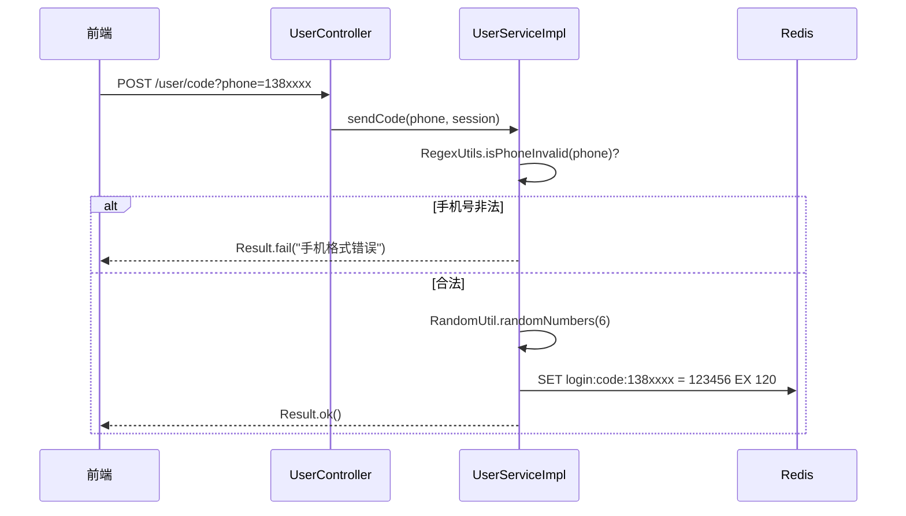
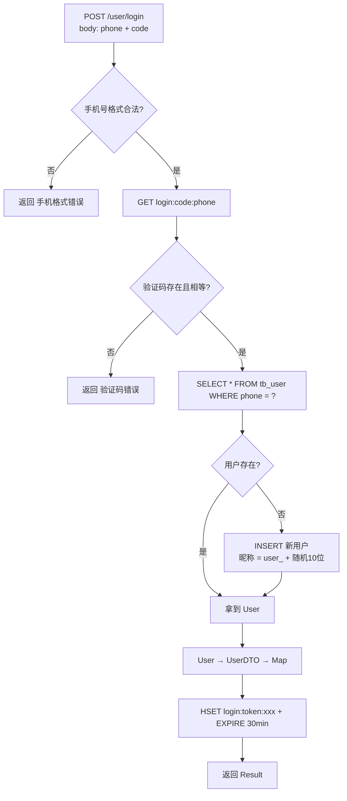
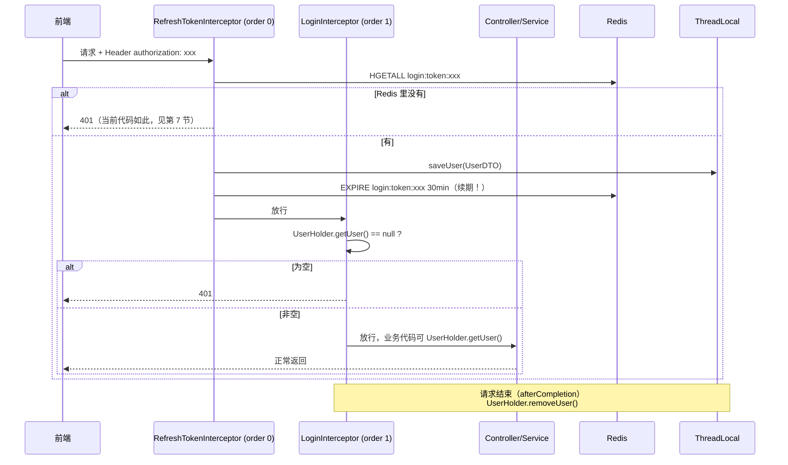
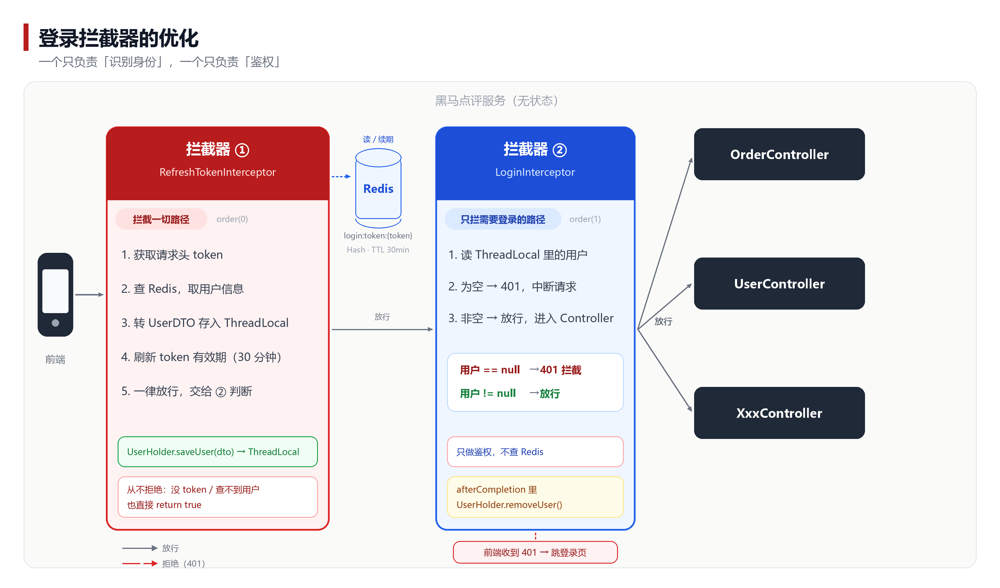

# 短信登录技术文档

> 这份文档对应仓库里的 commit `6eecff3 实现session到redis的转化,完成了短信登录的相关操作`。
> 全部讲解都对着你写的真实文件，行号可以直接跳过去看。
> 目标：让你合上视频也能自己画出这条链路、说出每个设计的原因。

---

## 0. 一句话概括

**把"用户是谁"这件事从服务器内存（HttpSession）搬到 Redis，用一个自己生成的 token 作为凭证，前端每次请求带上它，后端用两个拦截器把 token 翻译成用户对象。**

原来的做法：登录成功 → 服务器内存里存一个 session → 浏览器带 `JSESSIONID` cookie → 服务器按 cookie 找到 session。
现在的做法：登录成功 → Redis 里存 `login:token:xxx` → 前端存 token → 每次请求带 `authorization: xxx` → 拦截器查 Redis → 把用户放进 `ThreadLocal`。

---

## 1. 为什么不能继续用 HttpSession

先想清楚"换掉它"的理由，否则背下来也答不出面试题。

`HttpSession` 的本质是：**服务器（JVM）内存里的一张 Map**，key 是 `JSESSIONID`，value 是那个用户的数据。它有三个硬伤：

| 问题 | 具体表现 |
|---|---|
| **占内存、不能持久化** | 用户一多，session 全堆在 Tomcat 堆里；服务重启，所有人掉线 |
| **多实例就失效** | 部署 2 台服务器，A 机登录的 session 在 B 机不存在。要靠"会话粘滞"或"session 复制"补救，都很别扭 |
| **前后端分离/移动端不友好** | 依赖 Cookie 自动携带，App、小程序、跨域前端都得额外处理 |

而 token + Redis 的方案：

- 服务器**无状态**：任何一台实例拿到 token 都能去 Redis 查到用户，横向扩容直接生效；
- 服务重启不掉线（Redis 活着就行）；
- 前端用请求头传，不依赖 Cookie，天然适配 App / 小程序。

一句话：**不是 session 性能差，是 session 和"水平扩展"冲突。**

---

## 2. 先把四个新概念弄清楚

### 2.1 token 是什么，为什么用 UUID

token 就是一个**随机字符串**，作用是"一把钥匙"。用户登录成功后，服务器发给他一串 `550e8400-e29b-41d4-a716-446655440000` 这样的东西，之后他每次请求出示这串东西，服务器就认。

为什么不能直接用手机号当凭证？因为手机号是可以被任何人猜到的，它证明不了"你是你"。token 有两个要求：

1. **不可猜**（随机，长度够） → 用 UUID；
2. **能查回用户** → 所以 Redis 里要有 `token → 用户信息` 这条映射。

```java
// UserServiceImpl.java:75
String token = UUID.randomUUID().toString(true);   // true = 去掉中间的 "-"
```

Hutool 的 `UUID.randomUUID()` 生成的是 `cn.hutool.core.lang.UUID`，`.toString(true)` 去掉横线，得到 32 位十六进制串。

> 这里用 UUID 已经够了。真要做"无状态 token"（不查 Redis 就能验签），才会用 JWT —— 那是下一阶段的话题，本项目不涉及。

### 2.2 为什么用户信息存 Redis 的 Hash

存 `login:token:xxx` 时，你有两种选择：

```
方案 A（JSON 字符串）: SET login:token:xxx  {"id":1,"nickName":"user_abc","icon":"/imgs/1.png"}
方案 B（Hash）:        HSET login:token:xxx id 1 nickName user_abc icon /imgs/1.png
```

选 B 的理由：

- **可以单独读写某个字段**（比如只改昵称、只取 id），不用整个读出来再写回去；
- **不会因为某个字段为 null 把整个 JSON 写坏**；
- 和 Redis 命令一一对应，方便你 `redis-cli` 手动查、手动改，调试舒服；
- 存进去之后用 `entries` 一次性取回，转回对象只要一行。

代价是：字段的"类型"全丢了（Hash 里存的都是字符串），所以后面要注意 `Long id` 也要手动转。

### 2.3 ThreadLocal 是干什么的

想象一次 HTTP 请求进来：`Controller` → `Service` → `Mapper`，可能穿过七八层。如果在每一层都要"当前登录用户"，你会被迫给每个方法加一个 `UserDTO user` 参数，改到吐血。

`ThreadLocal` 是**绑定在线程上的一个变量**：同一线程里任何地方都能 `get`，别的线程看不到。Tomcat 是"一个请求一个线程"，所以它天然就是"这次请求的上下文"。

```java
// UserHolder.java:6-18
private static final ThreadLocal<UserDTO> tl = new ThreadLocal<>();
public static void saveUser(UserDTO user){ tl.set(user); }   // 拦截器里塞进去
public static UserDTO getUser(){ return tl.get(); }           // 业务代码任意地方取
public static void removeUser(){ tl.remove(); }               // 请求结束必须清掉
```

**为什么 `removeUser()` 不能省**（这是最容易被问的坑）：Tomcat 的线程是**线程池复用**的。这次请求用完的线程，下一次可能去处理别人的请求。如果不清，上一个用户的身份会"粘"到下一个人身上 —— 轻则数据串号，重则越权。

### 2.4 为什么用 `UserDTO` 而不是直接存 `User`

看 `UserDTO.java:6-10`，它只有三个字段：

```java
public class UserDTO { private Long id; private String nickName; private String icon; }
```

而 `User` 实体里有 `phone`、`password` 等敏感字段。往 Redis 或响应里塞 `User`，等于把手机号（和密码）泄给前端、写进缓存。

**DTO 的意义就是"只给该看的字段"**，这个习惯要保留。

---

## 3. 数据结构设计

这是整条链路的骨架，务必备下来：

| Redis Key | 类型 | Value | TTL | 写入方 | 读取方 |
|---|---|---|---|---|---|
| `login:code:{手机号}` | String | 6 位数字验证码 | **2 分钟** | `sendCode` | `login` |
| `login:token:{token}` | Hash | `id` / `nickName` / `icon` | **30 分钟**（每次访问刷新） | `login` | `RefreshTokenInterceptor` |

TTL 为什么是这两个数：

- **验证码 2 分钟**：短信验证码的有效期业界通常 1~5 分钟，太短用户收不到，太长被撞库；
- **登录态 30 分钟**：配合"每次请求刷新过期时间"= **滑动过期**。效果是"只要你还在用，就一直不掉线；静默 30 分钟后自动下线"。这是电商类 App 的常见体验。

> 注意：`RedisConstants.java` 里定义了 `LOGIN_USER_TTL = 36000L`（600 小时），但你代码里写死的是 `30 (分钟)`。**常量没被用上**，这个后面第 7 节会讲。

---

## 4. 全链路时序

### 4.1 发验证码



### 4.2 登录（两条分支：老用户 / 新用户）



### 4.3 之后每次请求（这是最关键的一段）



**读懂这张图，短信登录就懂 80% 了。** 两个拦截器分工是：

- `RefreshTokenInterceptor`（order 0）：**查 Redis、续期、塞 ThreadLocal**。它不管"要不要拦"，它只负责"如果有身份就把它放到当前线程"；
- `LoginInterceptor`（order 1）：**只看 ThreadLocal 里有没有人**，没有就 401。

---

## 5. 代码逐段精读

### 5.1 `sendCode` —— 发验证码

`src/main/java/com/hmdp/service/impl/UserServiceImpl.java:36-50`

```java
public Result sendCode(String phone, HttpSession session) {
    // 1. 校验手机号
    if (RegexUtils.isPhoneInvalid(phone)) {
        return Result.fail("手机格式错误");
    }
    // 2. 生成 6 位数字验证码
    String code = RandomUtil.randomNumbers(6);
    // 3. 存 Redis，2 分钟过期
    stringRedisTemplate.opsForValue().set("login:code" + phone, code, 2, TimeUnit.MINUTES);
    // 4. "发短信" —— 假的
    log.debug("验证码发送成功:{}", code);
    return Result.ok();
}
```

逐点解释：

- **为什么先校验手机号**：`/user/code` 是公开接口，谁都能调。先挡掉明显非法的，省一次 Redis 写，也让后续逻辑干净。
- **为什么验证码存在服务端**：如果只让前端生成/保存，用户随便伪造。验证码必须由服务端产生、服务端校验。
- **为什么 `TimeUnit.MINUTES` 而不是 `set(key, value, 120, TimeUnit.SECONDS)`**：都行，但显式写单位可读性更好。**千万不要写成 `Duration.ofMinutes(2)` 之外还漏了 TTL** —— 不带过期时间的 key 会永久堆积，是线上事故。
- **`log.debug` 的坑**：Spring Boot 默认日志级别是 INFO，`debug` **不会打印**。你要在 `application.yaml` 里把 `com.hmdp` 的级别调成 debug，或者临时改成 `log.info`，否则你会以为"验证码没生成"。

```yaml
# application.yaml 里加（可选）
logging:
  level:
    com.hmdp: debug
```

- **真实发短信**：这里应该是调用阿里云/腾讯云短信 SDK，把 `code` 发出去；现在是打日志模拟。这就是 commit 信息里"暂未使用云服务"的含义。

### 5.2 `login` —— 登录的核心

`UserServiceImpl.java:52-88`，分 7 步：

```java
// 1. 校验手机号
if (RegexUtils.isPhoneInvalid(phone)) return Result.fail("手机格式错误");

// 2. 从 Redis 取验证码并比对
String cacheCode = stringRedisTemplate.opsForValue().get("login:code" + phone);
if (cacheCode == null || !cacheCode.equals(code)) return Result.fail("验证码错误");
```

**这里的三个细节都要能答出来：**

1. `cacheCode == null` 必须在前面 —— 否则 `cacheCode.equals(code)` 直接 NPE；
2. 比较用 `cacheCode.equals(code)`，而不是 `code.equals(cacheCode)`。前者已经把 null 挡在前面了，所以顺序上其实都行，但**养成"常量/已知非空值在左边"的习惯**可以省掉一次判空；
3. **验证码是"服务端说了算"**：前端传上来的 `code` 只是用来核对，不参与任何生成。

```java
// 4-6. 查用户，没有就自动注册
User user = query().eq("phone", phone).one();
if (user == null) user = createUserWithPhone(phone);
```

这就是"**登录即注册**"：手机号 + 验证码这种模式里，用户根本分不清"注册"和"登录"，后端也不该分。第一次来就建号，之后直接查。

```java
// 7.1 生成 token
String token = UUID.randomUUID().toString(true);

// 7.2 User → UserDTO → Map
UserDTO userDTO = BeanUtil.copyProperties(user, UserDTO.class);
Map<String, Object> userMap = BeanUtil.beanToMap(userDTO, new HashMap<>(),
        CopyOptions.create()
                .setIgnoreNullValue(true)
                .setFieldValueEditor((fieldName, fieldValue) -> fieldValue.toString()));

// 7.3 存 Hash
stringRedisTemplate.opsForHash().putAll("login:token" + token, userMap);

// 7.4 设过期时间
stringRedisTemplate.expire("login:token" + token, 30, TimeUnit.MINUTES);

return Result.ok();   // ←←← 问题在这里，见第 7 节
```

**这段是全场最多问的，逐个点：**

- `BeanUtil.copyProperties(user, UserDTO.class)`：只拷**同名同类型**的字段（id / nickName / icon），多余的 phone、password 自动丢掉。
- `setIgnoreNullValue(true)`：DTO 里为 null 的字段不放进 Map，避免 Redis 里出现一堆空值。
- **`setFieldValueEditor` 是干嘛的？** `StringRedisTemplate` 的 value 序列化器是 `StringRedisSerializer`，**值只能是 String**。而 `userMap` 里 `id` 是 `Long`。不转换就会抛 `ClassCastException` / 序列化异常。这一行把每个值都 `toString()` 成字符串。
  > 副作用：从 Redis 读回来时，`id` 是 `"1"` 这种字符串，需要转回 `Long`。你用的 `BeanUtil.fillBeanWithMap(map, new UserDTO(), false)` 会自动做类型转换，所以没出问题。
- **为什么 `expire` 要单独一行？** 因为 `putAll` 没有带 TTL 的重载。先写后设过期是两步操作，中间那一刻 key 是全生命周期的 —— 生产代码更稳妥的做法是**先设置过期再写数据**，或者用 `Transaction`/Lua 保证原子。这里风险很小（用户拿到了又立刻过期也只是重新登录），知道就行。
- **`Result.ok()` 没把 token 返回给前端** —— 这是个**真的会让功能跑不通**的 bug，第 7 节细说。

### 5.3 `createUserWithPhone` —— 新用户落库

```java
// UserServiceImpl.java:90-98
User user = new User();
user.setPhone(phone);
user.setNickName(USER_NICK_NAME_PREFIX + RandomUtil.randomString(10)); // "user_" + 10位随机
save(user);
```

- `USER_NICK_NAME_PREFIX` 来自 `SystemConstants`，值是 `"user_"`；
- `save(user)` 是 MyBatis-Plus 的 `IService` 默认实现，等价于 `INSERT`，插入后**会把自增主键回填到 `user.id`** —— 所以后面 `BeanUtil.copyProperties` 能拿到 id 去存 Redis。这一点很多人不知道，值得记住。

### 5.4 两个拦截器：为什么是"两层"而不是一层

这是本功能**最核心的设计**，面试必问。先看图，建立结构感：



<sub>实线 = 放行，虚线 = 拒绝（401）。注意两个拦截器的执行顺序：**① 是 `order(0)`，② 是 `order(1)`**，写反了整个登录态就失效。</sub>

看懂之后，再逐行看代码：

`RefreshTokenInterceptor.java:24-49`（order 0，拦所有请求）

```java
String token = request.getHeader("authorization");
if (StrUtil.isBlank(token)) { response.setStatus(401); return false; }   // ← 第 7 节的问题
Map<Object, Object> userMap = stringRedisTemplate.opsForHash().entries(RedisConstants.LOGIN_USER_KEY + token);
if (userMap.isEmpty()) { response.setStatus(401); return false; }        // ← 同上
UserDTO userDTO = BeanUtil.fillBeanWithMap(userMap, new UserDTO(), false);
UserHolder.saveUser(userDTO);
stringRedisTemplate.expire(RedisConstants.LOGIN_USER_KEY + token, 30, TimeUnit.MINUTES);  // 续期
return true;
```

`LoginInterceptor.java:23-33`（order 1，只拦需要登录的路径）

```java
if (UserHolder.getUser() == null) { response.setStatus(401); return false; }
return true;
```

**为什么要拆成两个？** 因为有两件事必须分开：

| 要做的事 | 范围 | 放在哪 |
|---|---|---|
| 把 token 翻译成用户、刷新有效期 | **所有请求**（哪怕这个接口不需要登录，也要顺手续期） | RefreshTokenInterceptor（不排除任何路径） |
| 判断"这个接口需不需要登录、没登录就拦" | **部分请求**（`/shop/**`、`/blog/hot` 是公开的） | LoginInterceptor（带 excludePathPatterns） |

如果只用一个拦截器：你要么对所有路径都强制登录（公开页面全 401），要么对所有路径都放行（等于没鉴权）。

**另一个隐藏收益**：只要用户还在访问**任何**接口（包括不需要登录的），token 有效期就会被续上。真正"滑动的窗口"。

> ⚠️ 你现在这份 `RefreshTokenInterceptor` 把"没 token / 查不到用户"直接 401 了，等于把 LoginInterceptor 的活抢过来干了，会误伤公开接口。第 7 节给修法。

### 5.5 `MvcConfig` —— 拦截器怎么注册

`src/main/java/com/hmdp/config/MvcConfig.java:17-30`

```java
@Configuration
public class MvcConfig implements WebMvcConfigurer {

    @Resource
    private StringRedisTemplate stringRedisTemplate;   // ①

    @Override
    public void addInterceptors(InterceptorRegistry registry) {
        registry.addInterceptor(new LoginInterceptor(stringRedisTemplate))
                .excludePathPatterns("/user/code", "/user/login", "/blog/hot",
                        "/shop/**", "/shop-type/**", "/upload/**", "/voucher/**")
                .order(1);                              // ②

        registry.addInterceptor(new RefreshTokenInterceptor(stringRedisTemplate))
                .order(0);                              // ③
    }
}
```

三个知识点：

① **拦截器不是 Spring Bean**，所以不能用 `@Autowired` 直接注入到拦截器类里，得在配置类里手动 `new`，把依赖当构造参数传进去。这就是两个拦截器都有 `(StringRedisTemplate)` 构造函数的原因。

② **`excludePathPatterns` 的白名单**：

| 路径 | 为什么公开 |
|---|---|
| `/user/code`、`/user/login` | 登录之前，当然没有 token |
| `/blog/hot`、`/shop/**`、`/shop-type/**` | 首页店铺列表、热门博客，游客也要能看 |
| `/upload/**`、`/voucher/**` | 上传和优惠券相关的静态/公开接口 |

③ **`order` 越小越先执行**。`RefreshToken(0)` 必须在 `LoginInterceptor(1)` 之前，否则后者查 ThreadLocal 时永远是 null。**顺序错了，整个登录态就废了** —— 这是最典型的调试点。

---

## 6. 一次完整请求的代码调用链

以"登录后查看自己的信息" `GET /user/me` 为例：

| 顺序 | 发生什么 | 在哪 |
|---|---|---|
| 1 | 请求带 `authorization: 550e8400...` 到达 | 前端 |
| 2 | `RefreshTokenInterceptor.preHandle` 执行 | order 0 |
| 3 | 取 header，`HGETALL login:token:550e8400...` | Redis |
| 4 | `BeanUtil.fillBeanWithMap` → `UserDTO` | 拦截器 |
| 5 | `UserHolder.saveUser(dto)` | ThreadLocal |
| 6 | `EXPIRE ... 1800`（续期 30 分钟） | Redis |
| 7 | `LoginInterceptor.preHandle`：`UserHolder.getUser() != null` → 放行 | order 1 |
| 8 | `UserController.me()` 里 `UserHolder.getUser()` 拿到用户 | Controller |
| 9 | 返回 `Result.ok(user)` | 响应 |
| 10 | `afterCompletion` → `UserHolder.removeUser()` | 请求结束 |

第 10 步千万别漏 —— 前面 2.3 讲过为什么。

> 小观察：两个拦截器都实现了 `afterCompletion` 里的 `removeUser()`，等于**执行了两次**。`ThreadLocal.remove()` 是幂等的，无害，但重复代码该删一个。一般留在**最外层**（order 0，最后返回）那个里。

---

## 7. 你这份代码现在的问题（重要，先看这里）

这部分不是挑刺 —— 其中 **P0 的两条会让功能直接跑不通**，你复现的时候一定会撞上。

### 🔴 P0-1 登录成功没有把 token 返回给前端

`UserServiceImpl.java:87` 现在是：

```java
return Result.ok();          // data 是 null
```

前端拿到 `{success:true, data:null}`，**没有 token 可存**，于是后续所有请求都没有 `authorization` 头 → 全 401。

改成（`Result.ok(Object)` 会把参数放进 `data` 字段）：

```java
return Result.ok(token);
```

前端对应逻辑大致是：`res.data` 存进 `sessionStorage`，之后每个请求在 `axios` 拦截器里加 `config.headers['authorization'] = token`。

### 🔴 P0-2 `RefreshTokenInterceptor` 会把公开接口也挡掉

它**没有排除任何路径**，所以 `/shop/**`、`/blog/hot` 这些游客可见的接口也会走进来。而你写的是：

```java
if (StrUtil.isBlank(token)) { response.setStatus(401); return false; }   // 没登录直接 401
if (userMap.isEmpty())       { response.setStatus(401); return false; }   // token 失效直接 401
```

结果：**没登录的用户连首页都刷不出来**。

正确的分工是 —— 这个拦截器**只负责"如果有身份就放进来"，从不拒绝**：

```java
String token = request.getHeader("authorization");
if (StrUtil.isBlank(token)) {
    return true;                              // 没 token，放行；要不要拦交给 LoginInterceptor
}
Map<Object, Object> userMap = stringRedisTemplate.opsForHash()
        .entries(RedisConstants.LOGIN_USER_KEY + token);
if (userMap.isEmpty()) {
    return true;                              // token 无效，同样放行
}
UserDTO userDTO = BeanUtil.fillBeanWithMap(userMap, new UserDTO(), false);
UserHolder.saveUser(userDTO);
stringRedisTemplate.expire(RedisConstants.LOGIN_USER_KEY + token,
        RedisConstants.LOGIN_USER_TTL, TimeUnit.MINUTES);
return true;
```

至于 `LOGIN_USER_TTL = 36000` 是 600 小时，和你要的"30 分钟"不是一回事。**要么改常量，要么写死数值**，别一边定义 36000 一边用 30 —— 这是典型的"看起来有配置，其实没接上"。

### 🟠 P1-1 key 少了冒号，而且没用常量

```java
"login:code" + phone     // 实际生成 login:code13800000000
"login:token" + token    // 实际生成 login:token550e8400...
```

`RedisConstants` 里明明有 `LOGIN_CODE_KEY = "login:code:"` 和 `LOGIN_USER_KEY = "login:token:"`（注意**末尾带冒号**），你却自己拼字符串，结果少了分隔符。

虽然功能能跑（读写用的是同一个错误 key），但：

- `login:code13800000000` 这种 key 无法按前缀 `login:code:*` 批量扫；
- 两个 key 前缀粘连，看起来像脏数据；
- 常量定义了不用，等于给自己埋雷。

改成：

```java
stringRedisTemplate.opsForValue().set(RedisConstants.LOGIN_CODE_KEY + phone, code, RedisConstants.LOGIN_CODE_TTL, TimeUnit.MINUTES);
...
String tokenKey = RedisConstants.LOGIN_USER_KEY + token;
```

### 🟡 P2-1 验证码用完之后没删

现在验证码在校验成功后还留在 Redis 里 2 分钟，**可以被重复使用**（同一验证码连续登录多次）。虽然是 2 分钟窗口，但规范做法是用完即删：

```java
// 校验通过后
stringRedisTemplate.delete(RedisConstants.LOGIN_CODE_KEY + phone);
```

更进一步的做法是**校验失败也计数**（防暴力撞码），那就是限流的话题了，先不做。

### 🟡 P2-2 几处冗余

| 位置 | 现状 | 建议 |
|---|---|---|
| `UserServiceImpl.login(LoginFormDTO, HttpSession)` | `session` 参数已经不用了 | 删掉参数，Controller 同步改 |
| `LoginInterceptor` 构造函数 | 注入了 `stringRedisTemplate` 但完全没用到 | 改成无参构造 |
| 两个拦截器的 `afterCompletion` | 都 `removeUser()` | 只留一个（靠外层那个） |

### 🟡 P2-3 登出还没实现

`UserController.java:60-64` 还是 `Result.fail("功能未完成")`。有了 Redis 版 token，登出就一行：

```java
@PostMapping("/logout")
public Result logout(HttpServletRequest request) {
    String token = request.getHeader("authorization");
    if (StrUtil.isNotBlank(token)) {
        stringRedisTemplate.delete(RedisConstants.LOGIN_USER_KEY + token);
    }
    return Result.ok();
}
```

注意：`/user/logout` 现在**不在白名单里**，会被 LoginInterceptor 要求登录 —— 这其实是合理的（没登录谈何登出），但要确认前端在未登录时不会调它。

---

## 8. 自己动手验证（照着做一遍）

### 8.1 直接打接口（不需要前端）

```bash
# 1. 发验证码
curl -X POST "http://localhost:8081/user/code?phone=13800138000"

# 2. 去 Redis 里看验证码（或者看应用日志的 debug 输出）
redis-cli -h 118.190.157.75 -a <密码> --no-auth-warning get "login:code:13800138000"

# 3. 登录，拿到 token
curl -X POST http://localhost:8081/user/login \
  -H "Content-Type: application/json" \
  -d '{"phone":"13800138000","code":"你刚看到的6位"}'

# 4. 看 Redis 里的登录态
redis-cli -h 118.190.157.75 -a <密码> --no-auth-warning hgetall "login:token:<token>"
redis-cli -h 118.190.157.75 -a <密码> --no-auth-warning ttl    "login:token:<token>"

# 5. 带 token 访问受保护接口
curl http://localhost:8081/user/me -H "authorization: <token>"

# 6. 不带 token 访问公开接口（验证 P0-2 是否修好）
curl "http://localhost:8081/shop/1"
```

### 8.2 三条必测的负向用例

| 场景 | 期望 |
|---|---|
| 手机号 `123` 调 `/user/code` | `success:false, "手机格式错误"` |
| 验证码填错 / 填过期码 | `success:false, "验证码错误"` |
| token 乱写访问 `/user/me` | HTTP 401 |

### 8.3 用 Redis 命令理解 TTL

```bash
ttl login:token:xxx        # 看还剩多少秒
# 连续调几次 /user/me 后再看，应该被"续"回 1800 附近（滑动过期生效）
```

---

## 9. 面试问答（能背下来这 10 条，这一节就过关）

**Q1：为什么用 Redis 存登录态，不用 HttpSession？**
服务无状态，任意实例都能验，横向扩容不受影响；服务重启不掉线；不依赖 Cookie，适配前后端分离和 App。

**Q2：token 怎么生成的？为什么要随机？**
`UUID.randomUUID().toString(true)`，去掉横线的 32 位。随机是为了不可猜测 —— 如果直接用手机号/自增 id 当凭证，别人能伪造成任意用户。

**Q3：Redis 里为什么用 Hash 而不是 String？**
可以按字段独立读写，且不像 JSON 那样一个字段为 null 就整串坏了。代价是类型丢失，取回来要转。

**Q4：为什么还要一个 UserDTO？**
防止把 `User` 里的 phone、password 泄到前端和缓存，只暴露 id/昵称/头像。

**Q5：为什么要两个拦截器？**
一个负责"识别身份 + 续期"（拦所有请求，从不拒绝），一个负责"鉴权"（只拦需要登录的路径）。合并成一个，要么公开页面进不去，要么全放行没有安全性。

**Q6：ThreadLocal 为什么用完必须 remove？**
Tomcat 线程池复用线程，不清会导致下一个请求读到上一个用户的身份（串号/越权）；`ThreadLocal` 强引用也拖住对象影响回收。

**Q7：登录态 30 分钟是死的还是活的？**
活的（滑动过期）。每次请求 `EXPIRE` 重设，用户持续活跃就一直在线，静默 30 分钟才过期。

**Q8：`setFieldValueEditor` 那行不加会怎样？**
`StringRedisTemplate` 的值序列化器只接受 String，而 `id` 是 Long，写 Hash 时会类型转换/序列化异常。

**Q9：验证码为什么要存服务端、设 TTL？**
存前端等于用户可以伪造；不设 TTL 会永久堆积，且验证码可以无限期复用（安全风险）。

**Q10：这套方案有什么缺点？**
每次请求都要查一次 Redis（多一次网络 IO，可用本地缓存优化）；token 泄漏即身份被盗（要靠 HTTPS + 短 TTL + 主动踢下线）；Redis 挂了所有登录态失效（要考虑降级）。**能说出缺点，才是真的懂。**

---

## 10. 复习自测题（先别看答案）

<details>
<summary>1. 画出"用户带 token 访问 /user/me"的完整调用链，标出哪一步读 Redis、哪一步写 ThreadLocal。</summary>

请求 → RefreshTokenInterceptor.preHandle（HGETALL → fillBeanWithMap → saveUser → EXPIRE）→ LoginInterceptor.preHandle（判断 getUser 是否 null）→ UserController.me（getUser）→ afterCompletion（removeUser）。
</details>

<details>
<summary>2. 如果 MvcConfig 里把两个拦截器的 order 写反了，会怎样？</summary>

LoginInterceptor 先执行，此时 ThreadLocal 里必然是 null（还没人塞），所有需要登录的请求全部 401，登录成功后也进不去任何页面。
</details>

<details>
<summary>3. 为什么 Redis key 用 "login:token:{token}" 这种带冒号的层级命名？</summary>

冒号是社区的命名惯例，Redis 本身没有层级概念，但工具（RedisInsight）会按冒号折叠成树，也方便 `SCAN login:token:*` 按前缀运维。更重要的是：**冒号能防止前缀粘连歧义**，比如 `login:code` + `138...` 和 `login:code:` + `138...` 是两回事。
</details>

<details>
<summary>4. 用户改了昵称，Redis 里的登录态会立刻变吗？</summary>

不会。Redis 里是登录那一刻的快照。改完 DB 后要主动更新/删除 `login:token:*` 里的对应字段（或让用户重新登录）。这是"缓存双写"问题的缩影。
</details>

<details>
<summary>5. 现在这套代码，如果部署两台实例，能正常工作吗？</summary>

能 —— 这正是把 session 换成 Redis 的目的。任何实例都能用同一个 token 在共享 Redis 中查到用户。前提是两台实例连**同一个** Redis。
</details>

<details>
<summary>6. 验证码为什么不直接存成 "phone → code"？</summary>

必须加业务前缀 `login:code:`。否则手机号 key 和别的业务 key 混在一个命名空间，还可能和 token、其他缓存撞名，无法按业务清理。
</details>

---

## 11. 下一步（和 ROADMAP 1.1 对得上）

短信登录这条链路完成后，同一个"Redis 化"的思路还会复用在别处：

1. **登出**（删 token key）—— 10 分钟就能补上；
2. **改昵称后同步登录态** —— 两个写入口，需要"先更新 DB 再删缓存"；
3. **token 过期与续签策略** —— 现在是滑动 30 分钟，也可以做"双 token（access + refresh）"；
4. **防暴力破解** —— 验证码错误次数计数 + 手机号维度限流；
5. **会话安全** —— 同一账号多地登录是否互斥（Redis Set 存"用户 → 所有 token"）。

这几个都是面试里"那你下一步会怎么做"的标准答案，比"我加了 Redis 缓存"高级得多。

---

### 附：本文涉及的代码清单

| 文件 | 作用 |
|---|---|
| [UserController.java](src/main/java/com/hmdp/controller/UserController.java) | 暴露 `/user/code`、`/user/login`、`/user/me` |
| [UserServiceImpl.java](src/main/java/com/hmdp/service/impl/UserServiceImpl.java) | 发码、校验、注册、签发 token 的全部逻辑 |
| [UserDTO.java](src/main/java/com/hmdp/dto/UserDTO.java) | 对外暴露的用户字段（脱敏） |
| [UserHolder.java](src/main/java/com/hmdp/utils/UserHolder.java) | ThreadLocal 存当前请求的用户 |
| [RefreshTokenInterceptor.java](src/main/java/com/hmdp/utils/RefreshTokenInterceptor.java) | 识别身份 + 续期 |
| [LoginInterceptor.java](src/main/java/com/hmdp/utils/LoginInterceptor.java) | 鉴权（没登录就 401） |
| [MvcConfig.java](src/main/java/com/hmdp/config/MvcConfig.java) | 注册拦截器、配白名单、定顺序 |
| [RedisConstants.java](src/main/java/com/hmdp/utils/RedisConstants.java) | key 前缀与 TTL 常量（**代码里还没完全用上**） |
